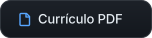
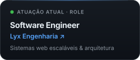
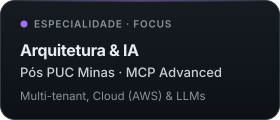
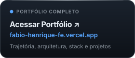
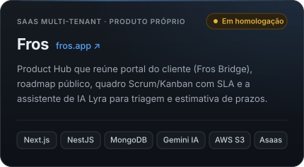
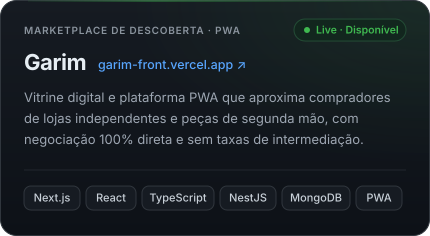
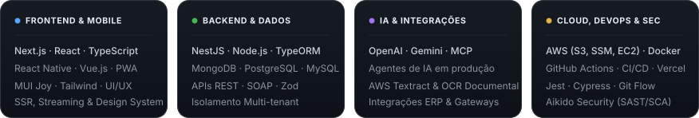
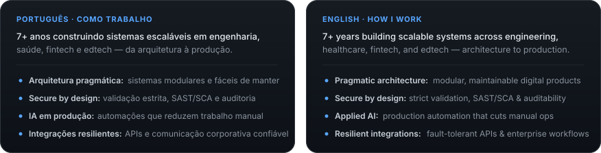

  

# Fábio Henrique Ferreira

**Software Engineer · Solutions Architect**  
Curitiba, PR · Brasil · Construindo produtos escaláveis, integrações e automação com IA da arquitetura à produção

 

  &nbsp;&nbsp;
  &nbsp;&nbsp;
  &nbsp;&nbsp;
  

 

  &nbsp;
  &nbsp;
  

 

## Produtos Autorais · Independent Products

  &nbsp;
  

 

## Tecnologias & Arquitetura · Tech Stack

  

  

 

## Atividade no GitHub · GitHub Activity

  &nbsp;
  

  

 

## Sobre & Como Trabalho · About & Principles

  

 

  <a href="https://fabio-henrique-fe.vercel.app"><strong>fabio-henrique-fe.vercel.app</strong></a> &nbsp;·&nbsp; <a href="https://fros.app"><strong>fros.app</strong></a> &nbsp;·&nbsp; <a href="https://garim-front.vercel.app"><strong>garim</strong></a> &nbsp;·&nbsp; <a href="https://www.linkedin.com/in/fabio-h-ferreira-zi"><strong>LinkedIn</strong></a>
    
  Let’s build something meaningful.

